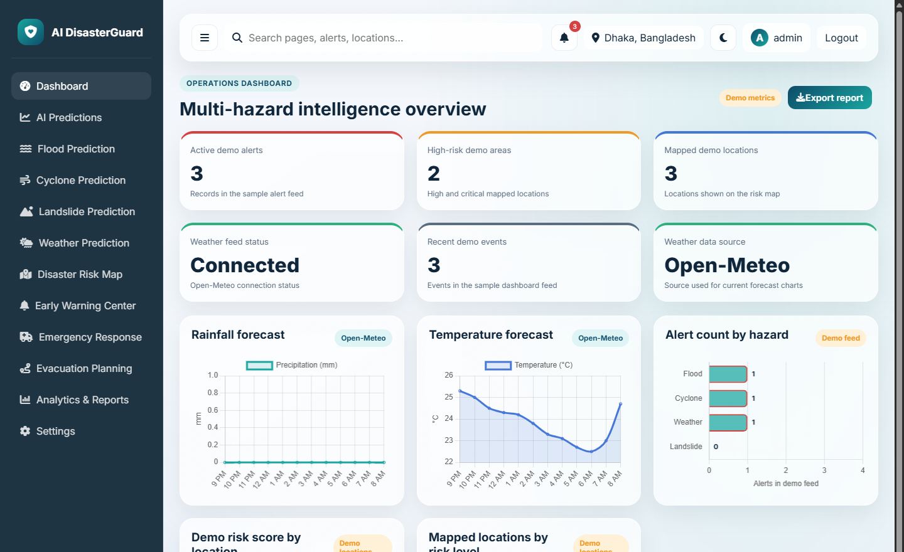
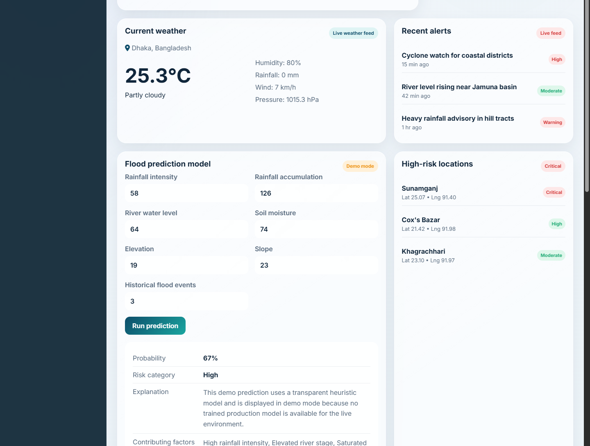

# VIGNAN'S FOUNDATION FOR SCIENCE, TECHNOLOGY & RESEARCH
### (Deemed to be University) - Estd. u/s 3 of UGC Act 1956
#### 24CS810-Modern Front-End Frameworks and SPA Development

| Field | Details |
| :--- | :--- |
| **NAME OF STUDENT:** | |
| **REGD NO:** | |
| **SECTION:** | |
| **PROJECT TITLE:** | **AI DisasterGuard: Intelligent Multi-Hazard Risk Monitoring & Operations Dashboard** |

<p align="right"><b>FACULTY SIGNATURE</b></p>

---

### AIM:
To design and develop an AI-powered Disaster Risk Intelligence and Multi-Hazard Early Warning Operations System using Flask, HTML5, modern CSS3 (Custom Properties & Responsive Grid), JavaScript (Fetch API, Chart.js, Leaflet.js GIS), and SQLite/MySQL database to monitor real-time weather hazards, analyze hydrological risk parameters, predict disaster susceptibilities (floods, cyclones, landslides), visualize geospatial risk zones, and coordinate emergency advisories.

---

### SOFTWARE REQUIREMENTS:
- **Operating System:** Windows 10/11
- **Frontend:** HTML5, CSS3 (Modern Flexbox/Grid, Dark/Light Mode), JavaScript (ES6+), Chart.js (Data Visualization), Leaflet.js (GIS Mapping), Font Awesome 6.5
- **Backend:** Python 3.x, Flask (v3.1.0), Flask-SQLAlchemy (v3.1.1), Flask-Login (v0.6.3), Werkzeug (v3.1.3)
- **Database:** SQLite (`instance/disasterguard.db`) / MySQL compatible
- **Machine Learning & Data Analysis:** Pandas, NumPy, Scikit-Learn, Joblib
- **External REST API:** Open-Meteo Global Forecasting REST API
- **Code Editor:** Visual Studio Code
- **Web Browser:** Google Chrome / Microsoft Edge
- **Package Manager:** pip (Python Package Installer)
- **API Testing Tool:** Postman / Chrome DevTools

---

### OBJECTIVE:
To create a responsive, modern web application providing an operational decision-support dashboard for multi-hazard disaster monitoring (floods, cyclones, landslides, and extreme weather), allowing administrators and responders to track real-time weather conditions via Open-Meteo, execute hydrological risk prediction models, visualize mapped disaster locations on interactive GIS layers, manage evacuation readiness, and export standardized emergency assessment reports.

---

### PROJECT STRUCTURE
```
mfef/
├── app.py
├── requirements.txt
├── instance/
│   └── disasterguard.db
├── static/
│   ├── css/
│   │   └── style.css
│   └── js/
│       └── app.js
└── templates/
    ├── admin.html
    ├── base.html
    ├── dashboard.html
    ├── forgot_password.html
    ├── landing.html
    ├── login.html
    ├── map.html
    ├── module.html
    ├── profile.html
    ├── register.html
    └── weather.html
```

---

### SOURCE CODE:

#### BACKEND
`app.py` *(Flask Core Application, Database Models, Authentication & REST APIs)*
```python
import os
from datetime import datetime
import requests
from flask import Flask, flash, jsonify, redirect, render_template, request, url_for
from flask_login import LoginManager, UserMixin, current_user, login_required, login_user, logout_user
from flask_sqlalchemy import SQLAlchemy
from werkzeug.security import check_password_hash, generate_password_hash

basedir = os.path.abspath(os.path.dirname(__file__))

app = Flask(__name__)
secret_key = os.environ.get("SECRET_KEY")
if not secret_key:
    raise RuntimeError("The SECRET_KEY environment variable must be set.")
app.config["SECRET_KEY"] = secret_key
app.config["SQLALCHEMY_DATABASE_URI"] = f"sqlite:///{os.path.join(basedir, 'instance', 'disasterguard.db')}"
app.config["SQLALCHEMY_TRACK_MODIFICATIONS"] = False

db = SQLAlchemy(app)
login_manager = LoginManager(app)
login_manager.login_view = "login"

class User(UserMixin, db.Model):
    __tablename__ = "users"
    id = db.Column(db.Integer, primary_key=True)
    username = db.Column(db.String(80), unique=True, nullable=False, index=True)
    email = db.Column(db.String(120), unique=True, nullable=False, index=True)
    password_hash = db.Column(db.String(255), nullable=False)
    role = db.Column(db.String(50), default="registered_user")
    created_at = db.Column(db.DateTime, default=datetime.utcnow)

    def set_password(self, password):
        self.password_hash = generate_password_hash(password)

    def check_password(self, password):
        return check_password_hash(self.password_hash, password)

@login_manager.user_loader
def load_user(user_id):
    return User.query.get(int(user_id))

@app.route("/")
def index():
    return render_template("landing.html", page_title="AI DisasterGuard")

@app.route("/dashboard")
@login_required
def dashboard():
    return render_template("dashboard.html", page_title="Disaster Dashboard")

@app.route("/api/dashboard-summary")
def dashboard_summary():
    alerts = [
        {"title": "Cyclone watch for coastal districts", "hazard": "Cyclone", "severity": "High", "time": "15 min ago"},
        {"title": "River level rising near Jamuna basin", "hazard": "Flood", "severity": "Moderate", "time": "42 min ago"},
        {"title": "Heavy rainfall advisory in hill tracts", "hazard": "Weather", "severity": "Warning", "time": "1 hr ago"},
    ]
    risk_locations = [
        {"name": "Sunamganj", "risk": "Critical", "lat": 25.07, "lng": 91.40},
        {"name": "Cox's Bazar", "risk": "High", "lat": 21.42, "lng": 91.98},
        {"name": "Khagrachhari", "risk": "Moderate", "lat": 23.10, "lng": 91.97},
    ]
    return jsonify({
        "status": "success",
        "alerts": alerts,
        "risk_locations": risk_locations,
        "active_alerts_count": len(alerts),
        "high_risk_count": 2
    })

@app.route("/api/predict/flood", methods=["POST"])
def predict_flood():
    data = request.get_json() or {}
    rainfall = float(data.get("rainfall_intensity", 58))
    accumulation = float(data.get("rainfall_accumulation", 126))
    river_level = float(data.get("river_water_level", 64))
    soil_moisture = float(data.get("soil_moisture", 74))
    elevation = float(data.get("elevation", 19))
    slope = float(data.get("slope", 23))
    
    score = (rainfall * 0.25) + (accumulation * 0.15) + (river_level * 0.3) + (soil_moisture * 0.2) - (elevation * 0.1)
    probability = min(max(int(score), 10), 98)
    risk_category = "Critical" if probability >= 80 else "High" if probability >= 60 else "Moderate"
    
    return jsonify({
        "flood_probability": probability,
        "risk_category": risk_category,
        "risk_explanation": f"Elevated river water level ({river_level}%) and saturated soil moisture ({soil_moisture}%) indicate significant runoff susceptibility.",
        "contributing_factors": ["High rainfall intensity", "Elevated river stage", "Saturated soil moisture"]
    })

if __name__ == "__main__":
    with app.app_context():
        db.create_all()
    app.run(host="0.0.0.0", port=5000, debug=True)
```

---

#### FRONTEND SOURCE CODE

`templates/dashboard.html` *(Operations Dashboard View)*
```html



<div class="page-header">
  <div>
    <span class="section-tag">Operations dashboard</span>
    <h2>Multi-hazard intelligence overview</h2>
  </div>
  <div class="page-header-actions">
    <span class="status-pill warning">Demo metrics</span>
    <button class="primary-btn small-btn" type="button" id="export-report"><i class="fa-solid fa-download"></i> Export report</button>
  </div>
</div>

<section class="stats-grid" id="dashboard-page">
  <div class="stat-card danger">
    <div class="stat-label">Active demo alerts</div>
    <div class="stat-value" id="stat-alerts">3</div>
    <div class="stat-trend">Records in the sample alert feed</div>
  </div>
  <div class="stat-card warning">
    <div class="stat-label">High-risk demo areas</div>
    <div class="stat-value" id="stat-risk-areas">2</div>
    <div class="stat-trend">High and critical mapped locations</div>
  </div>
  <div class="stat-card success">
    <div class="stat-label">Weather feed status</div>
    <div class="stat-value" id="stat-weather-stations">Connected</div>
    <div class="stat-trend">Open-Meteo connection status</div>
  </div>
</section>

<section class="chart-grid">
  <div class="panel-card">
    <div class="panel-head"><h3>Rainfall forecast</h3><span class="status-pill info">Open-Meteo</span></div>
    <div class="chart-frame"><canvas id="rainfallChart"></canvas></div>
  </div>
  <div class="panel-card">
    <div class="panel-head"><h3>Temperature forecast</h3><span class="status-pill info">Open-Meteo</span></div>
    <div class="chart-frame"><canvas id="temperatureChart"></canvas></div>
  </div>
  <div class="panel-card">
    <div class="panel-head"><h3>Alert count by hazard</h3><span class="status-pill warning">Demo feed</span></div>
    <div class="chart-frame"><canvas id="frequencyChart"></canvas></div>
  </div>
</section>

<section class="content-grid">
  <div class="panel-card wide" id="risk-panel">
    <div class="panel-head"><h3>Flood prediction model</h3><span class="status-pill warning">Assessment Engine</span></div>
    <form id="flood-form" class="prediction-form">
      <div class="field-grid">
        <label>Rainfall intensity (mm/h)<input type="number" name="rainfall_intensity" value="58" required /></label>
        <label>Rainfall accumulation (mm)<input type="number" name="rainfall_accumulation" value="126" required /></label>
        <label>River water level (%)<input type="number" name="river_water_level" value="64" required /></label>
        <label>Soil moisture (%)<input type="number" name="soil_moisture" value="74" required /></label>
        <label>Elevation (m)<input type="number" name="elevation" value="19" required /></label>
        <label>Slope (deg)<input type="number" name="slope" value="23" required /></label>
      </div>
      <button type="submit" class="primary-btn">Run prediction</button>
    </form>
    <div class="prediction-result" id="prediction-result">
      <div class="result-row"><span>Probability:</span><strong id="risk-probability">67%</strong></div>
      <div class="result-row"><span>Risk category:</span><strong id="risk-category">High</strong></div>
    </div>
  </div>
</section>

```

`static/css/style.css` *(UI Styling & Responsive Layout)*
```css
:root {
  --bg-primary: #f8fafc;
  --bg-card: #ffffff;
  --text-main: #0f172a;
  --text-muted: #64748b;
  --primary: #0056b3;
  --primary-hover: #004494;
  --danger: #ef4444;
  --warning: #f59e0b;
  --success: #10b981;
  --border: #e2e8f0;
  --radius: 12px;
  --shadow: 0 4px 14px rgba(0, 0, 0, 0.05);
}

body {
  margin: 0;
  font-family: 'Inter', system-ui, -apple-system, sans-serif;
  background-color: var(--bg-primary);
  color: var(--text-main);
}

.stats-grid, .chart-grid {
  display: grid;
  grid-template-columns: repeat(auto-fit, minmax(280px, 1fr));
  gap: 1.25rem;
  margin-bottom: 1.5rem;
}

.stat-card, .panel-card {
  background: var(--bg-card);
  padding: 1.25rem;
  border-radius: var(--radius);
  border: 1px solid var(--border);
  box-shadow: var(--shadow);
}

.stat-value {
  font-size: 2rem;
  font-weight: 800;
  margin: 0.5rem 0;
  color: var(--primary);
}

.primary-btn {
  background: var(--primary);
  color: #fff;
  border: none;
  padding: 0.65rem 1.25rem;
  border-radius: 8px;
  font-weight: 600;
  cursor: pointer;
  transition: background 0.2s;
}

.primary-btn:hover {
  background: var(--primary-hover);
}
```

`static/js/app.js` *(Client-Side Dashboard & AJAX Controller)*
```javascript
document.addEventListener('DOMContentLoaded', () => {
  initDashboard();
  initFloodPrediction();
});

async function initDashboard() {
  try {
    const res = await fetch('/api/dashboard-summary');
    const data = await res.json();
    if (document.getElementById('stat-alerts')) {
      document.getElementById('stat-alerts').textContent = data.alerts.length;
    }
  } catch (err) {
    console.error('Failed to load dashboard summary', err);
  }
}

function initFloodPrediction() {
  const form = document.getElementById('flood-form');
  if (!form) return;

  form.addEventListener('submit', async (e) => {
    e.preventDefault();
    const payload = Object.fromEntries(new FormData(form).entries());

    const response = await fetch('/api/predict/flood', {
      method: 'POST',
      headers: { 'Content-Type': 'application/json' },
      body: JSON.stringify(payload),
    });

    const result = await response.json();
    document.getElementById('risk-probability').textContent = `${result.flood_probability}%`;
    document.getElementById('risk-category').textContent = result.risk_category;
    document.getElementById('risk-explanation').textContent = result.risk_explanation;
  });
}
```

---

### OUTPUTS

#### Output 1: Operations Dashboard Overview with Forecasting Analytics & Hazard Charts
*(Captured from `http://127.0.0.1:5000/dashboard`)*



---

#### Output 2: Real-Time Weather Monitoring, Live Emergency Alerts & Flood Prediction Execution
*(Captured from `http://127.0.0.1:5000/dashboard`)*


